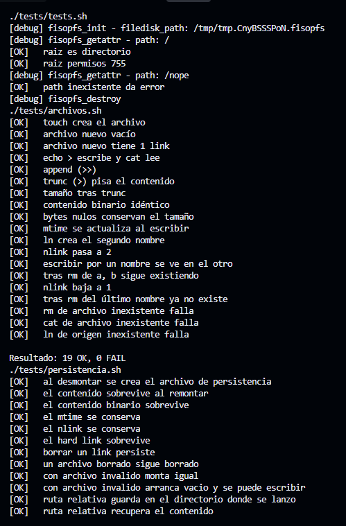
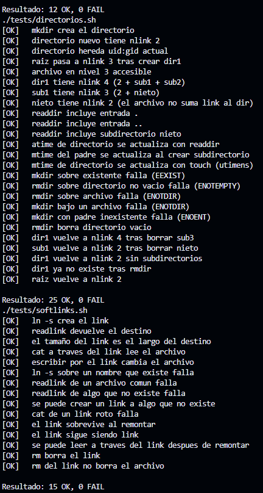

# filesystem

## Diseño de estructuras

### Tabla de inodos

El filesystem vive en memoria como una tabla estática de `MAX_INODES` inodos (`fs_t`). Cada inodo (`inode_t`) describe un archivo o un directorio que guarda el tipo, permisos, uid/gid, `nlink`, tamaño, los tres tiempos y el contenido. Los directorios no tienen punteros a sus hijos, sino que tienen una lista de entradas `(nombre, índice de inodo)` para que todo el filesystem se puede volcar a disco con un solo `sizeof(fs_t)`.

### Búsqueda por path

Para encontrar un archivo, `fs_lookup` recorre el path componente por componente con `strtok_r` (partiendo del inodo 0). Por cada nombre, se busca la entrada en el directorio actual y se devuelve `-ENOENT`, `-ENOTDIR` o `-ENAMETOOLONG` según el caso (si no existe, si no es un directorio o si el path/nombre es muy largo).

### Límites

Los límites son constantes fijas, para que la tabla sea de tamaño estático y no tengamos que manejar memoria dinámica:

| Constante        | Valor | Motivo                              |
|------------------|-------|-------------------------------------|
| MAX_INODES       | 256   | tamaño fijo de la tabla             |
| MAX_NAME         | 64    | largo máximo de un nombre           |
| MAX_PATH         | 256   | largo máximo de un path             |
| MAX_DEPTH        | 16    | niveles máximos de directorios      |
| MAX_DIR_ENTRIES  | 32    | entradas máximas por directorio     |
| MAX_FILE_SIZE    | 4096  | tamaño máximo de un archivo         |


### Formato de serialización

Para guardar el filesystem en disco se escribe todo el `fs_t` tal cual esta en memoria. Esto se puede porque no usamos punteros. La tabla de inodos, los nombres, las entradas de los directorios y el contenido de los archivos son todos arreglos de tamaño fijo. Entonces lo que se guarda es lo mismo que despues se carga y no hay que reconstruir nada.

El archivo empieza con un encabezado de 16 bytes. Primero va un numero que identifica al archivo (`0x46495350` que son las letras fisp) y despues el tamaño que deberian tener los datos. Despues del encabezado van los 256 inodos de 4152 bytes cada uno. Al cargar se chequea que el numero y el tamaño coincidan. Si no coinciden no se usa el archivo y el filesystem arranca vacio.

```
 offset 0          8         16                                   16 + 256*4152
   +---------------+---------+---------+---------+-----+-----------+
   |  magic (8 B)  | size    | inodo 0 | inodo 1 | ... | inodo 255 |
   |  "FISP"       | (8 B)   | 4152 B  | 4152 B  |     | 4152 B    |
   +---------------+---------+---------+---------+-----+-----------+
   |<--- header --->|<------------- sizeof(fs_t) = 1.062.912 B ---->|
```

El archivo completo pesa 16 + 256 * 4152 = 1.062.928 bytes

#### Cuando se carga y cuando se guarda

El archivo de persistencia se llama como le pasamos en `--filedisk` y termina en `.fisopfs`. Si no pasamos nada se usa `persistence_file.fisopfs`.

Cuando se monta se lee todo el archivo en `init` y despues se trabaja solo en memoria. Si el archivo no existe es la primera vez y arranca vacio. Si existe pero no tiene el formato correcto avisa por stderr y arranca vacio tambien.

Se guarda todo de nuevo en `destroy` cuando se desmonta y en `flush` cada vez que se cierra un archivo. Si falla el guardado en `flush` devuelve `EIO`.

#### Path absoluto

Cuando corre en background FUSE hace un `chdir("/")`. Entonces una ruta relativa ya no apunta a donde queremos. Por eso en el `main` pasamos la ruta de `--filedisk` a absoluta antes de llamar a `fuse_main`.

#### Limitaciones

- Si cambiamos las constantes de `fs.h` cambia el tamaño de `fs_t` y los archivos viejos no sirven mas. Se detecta por el tamaño y arranca vacio.
- Guardar no es atomico. Si se corta justo mientras guarda el archivo puede quedar incompleto.
- No usamos locks. Asumimos que FUSE atiende los pedidos de a uno. Si atendiera varios a la vez habria que proteger la estructura.
- Cada `flush` escribe todo el archivo que pesa mas de 1 MB.

### Archivos y hard links

**Contenido.** Los bytes de un archivo viven en `file_data[MAX_FILE_SIZE]`, dentro de la `union` del inodo, y `size` indica cuántos son válidos. Se copian con `memcpy` usando `size` (nunca `strlen`), así el contenido binario con bytes nulos se conserva.

**Operaciones sobre los bytes** (`fs_files.c`, trabajan sobre un `inode_t` y no conocen FUSE):

| Operación | Comportamiento |
|-----------|----------------|
| `read`    | si el offset es >= `size` devuelve 0 (EOF); si se piden más bytes de los que hay, devuelve solo los que hay; actualiza `atime` |
| `write`   | si el offset pasa del final rellena el hueco con ceros; `size` solo crece si `offset + size` lo supera; actualiza `mtime` y `ctime`; `-EFBIG` si se pasa de `MAX_FILE_SIZE` |
| `truncate`| agranda rellenando con ceros o achica bajando `size`; `-EFBIG` si se pasa del máximo |

Append (`>>`) no necesita código propio: el kernel manda un `write` con el offset en el tamaño actual. Trunc (`>`) llega como `truncate` a 0 seguido de un `write`.

**Hard links.** El nombre no está en el archivo: un directorio guarda parejas `(nombre, índice de inodo)`, así que dos nombres pueden apuntar al mismo inodo. `nlink` cuenta cuántos nombres tiene.

```text
  directorio raíz (inodo 0)              inodo 5
  +----------------------+          +------------------+
  | "a.txt" -> 5         |--------->| type  = T_FILE   |
  | "b.txt" -> 5         |--------->| nlink = 2        |
  +----------------------+          | size  = 11       |
                                    | file_data = ...  |
                                    +------------------+
```

- `create`: verifica que el path no exista, busca el directorio padre con `fs_lookup_parent`, aloca un inodo (`nlink` = 1) y agrega la entrada. Si agregar la entrada falla, libera el inodo para no dejarlo huérfano.
- `link`: agrega una entrada nueva que apunta al inodo existente y sube `nlink`. Falla con `-EPERM` si el origen es un directorio, `-EEXIST` si el destino ya existe y `-ENOENT` si el origen no existe.
- `unlink`: quita la entrada del directorio y baja `nlink`. Recién cuando llega a 0 se libera el inodo, por eso el contenido sigue accesible mientras quede algún nombre. Falla con `-EISDIR` si es un directorio.

**Limitaciones.** Un archivo no puede superar `MAX_FILE_SIZE` bytes. No se permiten hard links a directorios.

### Directorios, anidamiento y metadatos

**Representación y pseudo-directorios.** Dentro de la `union` del inodo, un directorio almacena un arreglo estático `entries[MAX_DIR_ENTRIES]` de parejas `(nombre, índice de inodo)` y un contador `count`. Las entradas `.` y `..` no se guardan dentro de `entries[]`, sino que `fs_readdir` las emite dinámicamente al listar. Esto permite aprovechar los 32 lugares completos para hijos reales y verificar si un directorio está vacío chequeando simplemente `count == 0`.

**Anidamiento multinivel y contador de links (`nlink`).** Para crear o borrar nodos en cualquier nivel de profundidad (hasta `MAX_DEPTH`), `fs_lookup_parent` separa el path padre del nombre final (`strrchr`) y resuelve el padre con `fs_lookup`. Todo directorio nace con `nlink = 2` (su entrada en el padre más su propio `.`). Cada subdirectorio creado incrementa en 1 el `nlink` de su directorio padre (por el `..` del hijo), mientras que los archivos regulares no lo modifican.

~~~text
  inodo 0: "/" (nlink = 3)
  +------------------+
  | "dir1" -> 1      |
  +------------------+
           |
           v
  inodo 1: "/dir1" (nlink = 4)
  +------------------+
  | "sub1" -> 2      |-----> inodo 2: "/dir1/sub1" (nlink = 3)
  | "sub2" -> 3      |         +------------------+
  +------------------+         | "nieto" -> 4     |-----> inodo 4: "/dir1/sub1/nieto" (nlink = 2)
           |                   +------------------+         +-----------------------+
           v                                                | "archivo.txt" -> 5    |
  inodo 3: "/dir1/sub2" (nlink = 2)                         +-----------------------+
~~~

**Operaciones de directorios y tiempos** (`fs.c`, independientes de FUSE):

| Operación | Comportamiento y actualización de metadatos |
|-----------|---------------------------------------------|
| `mkdir`   | valida profundidad (`-ENAMETOOLONG`), resuelve el padre con `fs_lookup_parent`, aloca un inodo `T_DIR` (`nlink = 2`, `uid`/`gid` del proceso actual) y lo agrega al padre; incrementa `parent->nlink` y actualiza `mtime` y `ctime` del padre; falla con `-EEXIST` si ya existe o `-ENOSPC` si no hay lugar |
| `readdir` | resuelve el directorio, emite `.`, `..` y las `count` entradas activas, y actualiza `atime` del directorio; falla con `-ENOTDIR` si no es directorio |
| `rmdir`   | verifica que exista (`-ENOENT`), que sea directorio (`-ENOTDIR`) y que `count == 0` (`-ENOTEMPTY`); quita la entrada, decrementa `parent->nlink`, actualiza `mtime` y `ctime` del padre y libera el inodo; falla con `-EBUSY` sobre `/` |
| `getattr` | copia `mode`, `nlink`, `uid`, `gid`, `size`, `atime`, `mtime` y `ctime` al `struct stat` |
| `utimens` | actualiza `atime` y `mtime` del inodo (usado por `touch`) y setea `ctime` al instante actual |

**Limitaciones.** No se puede superar `MAX_DEPTH` (16 niveles) ni `MAX_DIR_ENTRIES` (32 entradas por directorio).
### Soft links

Un soft link es un archivo aparte con un tipo especial (`T_SYMLINK`) y lo unico que tiene adentro es la ruta a la que apunta. No es lo mismo que un hard link. El hard link es otro nombre para el mismo inodo y el soft link tiene su propio inodo. Por eso el soft link nunca apunta al inodo del archivo, solo guarda un texto con el camino.

Ese texto se guarda en `file_data` igual que el contenido de un archivo comun. `size` es el largo de la ruta y el modo es `S_IFLNK | 0777`. Ocupa lo que ocupa una ruta corta.

```text
  "link" -> inodo 7              "hola.txt" -> inodo 5
       |                                  |
       v                                  v
  +----------------------+          +------------------+
  | type = T_SYMLINK     |          | type = T_FILE    |
  | size = 8             |          | nlink = 1        |
  | file_data = hola.txt |  - - - > | file_data = ...  |
  +----------------------+          +------------------+
        el kernel lee "hola.txt" y lo busca de nuevo por path
```

Leer a traves de un soft link son dos pasos. Primero se lee el link para saber a donde apunta y despues se busca esa ruta de nuevo para llegar al archivo. Esto lo hace el kernel: nos pide `readlink` y despues vuelve a llamar a `getattr` y `read` con la ruta nueva. Nosotros solo tuvimos que implementar dos operaciones:

- `symlink`: verifica que el nombre no exista, aloca un inodo `T_SYMLINK`, copia el destino en `file_data` y agrega la entrada en el directorio. Devuelve `-EEXIST` si el nombre ya existe y `-ENAMETOOLONG` si el destino no entra en el inodo.
- `readlink`: devuelve el texto guardado. Devuelve `-EINVAL` si el inodo no es un link.

`unlink` no necesito cambios: borra el link como cualquier archivo y no toca el destino. Tampoco hubo que tocar la persistencia, porque el link es un inodo mas y se guarda con todo el `fs_t`.

| | Hard link | Soft link |
|---|-----------|-----------|
| Inodo | el mismo que el archivo | uno propio de tipo `T_SYMLINK` |
| Si borramos el destino | sigue funcionando | se rompe |
| Si borramos el link | baja el `nlink` del archivo | se libera el inodo del link y el archivo no cambia |
| Que se chequea | que el origen exista y no sea un directorio | nada, no se valida el destino |

**Limitaciones.** El destino no puede tener mas de `MAX_FILE_SIZE - 1` bytes. Como no se valida el destino se puede crear un link roto.

---

## Diseño de pruebas

### Entorno donde corrimos las pruebas

Corrimos las pruebas en Ubuntu 24.04 sobre WSL2 (kernel 6.6.87.2-microsoft-standard-WSL2). Compilamos con gcc 13.3.0 y libfuse 2.9.9. Todas las salidas de abajo salen de `make test` en ese entorno

### Ejecución completa de las pruebas

Esta es la salida de `make test` que corre los cinco scripts de pruebas uno atras del otro





### Pruebas de archivos y hard links

`tests/archivos.sh` monta el filesystem en un directorio temporal, con un archivo de persistencia propio que borra al terminar, ejecuta los comandos de la tabla y compara el resultado con el esperado. Imprime `[OK]` o `[FAIL]` por cada chequeo y devuelve 0 solo si todos pasan. Se corre con `./tests/archivos.sh`.

| Funcionalidad | Comando | Resultado esperado |
|---------------|---------|--------------------|
| Creación | `touch a.txt` | existe, tamaño 0, 1 link |
| Escritura y lectura | `echo hola > a.txt; cat a.txt` | `hola` |
| Append | `echo mundo >> a.txt` | `hola` y `mundo` en líneas separadas |
| Trunc | `echo x > a.txt` | solo `x`, tamaño 2 |
| Binario | copiar 1000 bytes aleatorios y `cmp` | idénticos |
| Bytes nulos | `printf 'a\0b\0c' > nul` | tamaño 5 |
| Fechas | escribir un segundo después | `mtime` aumenta |
| Hard link | `ln a.txt b.txt` | contenido compartido, `nlink` 2, escribir por `b` se ve en `a` |
| Borrado con links | `rm a.txt` | `b.txt` sigue con el contenido y `nlink` 1 |
| Borrado final | `rm b.txt` | ya no existe |
| Errores | `rm`, `cat` y `ln` sobre un archivo inexistente | fallan |

Dos decisiones de las pruebas:

- Se monta con `-o attr_timeout=0`. Con la caché de atributos por defecto, el kernel puede mostrar el tamaño viejo por el otro nombre de un hard link hasta 1 segundo después de escribir. Es una limitación del montaje FUSE, que cachea por path, y no de la estructura de inodos.
- No se compara el número de inodo con `stat -c %i`, porque FUSE de alto nivel asigna `st_ino` por path salvo que se monte con `-o use_ino`. El compartimiento del inodo se verifica por comportamiento: contenido compartido y `nlink` que sube a 2 y baja a 1.

Salida de la corrida:

```text
[OK]   touch crea el archivo
[OK]   archivo nuevo vacío
[OK]   archivo nuevo tiene 1 link
[OK]   echo > escribe y cat lee
[OK]   append (>>)
[OK]   trunc (>) pisa el contenido
[OK]   tamaño tras trunc
[OK]   contenido binario idéntico
[OK]   bytes nulos conservan el tamaño
[OK]   mtime se actualiza al escribir
[OK]   ln crea el segundo nombre
[OK]   nlink pasa a 2
[OK]   escribir por un nombre se ve en el otro
[OK]   tras rm de a, b sigue existiendo
[OK]   nlink baja a 1
[OK]   tras rm del último nombre ya no existe
[OK]   rm de archivo inexistente falla
[OK]   cat de archivo inexistente falla
[OK]   ln de origen inexistente falla

Resultado: 19 OK, 0 FAIL
```

### Pruebas de directorios y metadatos

`tests/directorios.sh` monta el filesystem en un directorio temporal con `-o attr_timeout=0` y verifica creación, anidamiento en múltiples niveles, evolución de `st_nlink`, listado con `.` y `..`, actualización de timestamps y códigos de error. Se ejecuta individualmente con `./tests/directorios.sh` o junto a toda la batería con `make test`.

| Funcionalidad | Comando | Resultado esperado |
|---------------|---------|--------------------|
| Creación y stats | `mkdir dir1` | tipo directorio, `nlink` 2, `uid:gid` actual, raíz sube a `nlink` 3 |
| Anidamiento | `mkdir dir1/sub1 dir1/sub2 dir1/sub1/nieto` | acceso en nivel 3, `dir1` con `nlink` 4 y `sub1` con `nlink` 3 |
| Archivos en subdirs | `echo contenido > dir1/sub1/nieto/archivo.txt` | contenido legible, `nieto` mantiene `nlink` 2 |
| Listado | `ls -la dir1/sub1` | incluye `.`, `..` y `nieto` |
| Fechas | `ls`, `mkdir` hijo y `touch dir1` tras 1 segundo | `atime` sube con `readdir`; `mtime` sube con `mkdir` hijo y `touch` |
| Errores | `mkdir` existente, `rmdir` no vacío o sobre archivo, `mkdir` bajo archivo o padre inexistente | fallan con `EEXIST`, `ENOTEMPTY`, `ENOTDIR` y `ENOENT` |
| Borrado | `rmdir` de hojas a raíz | libera los directorios y decrementa `nlink` de cada padre hasta volver a 2 |

Salida de la corrida:

~~~text
[OK]   mkdir crea el directorio
[OK]   directorio nuevo tiene nlink 2
[OK]   directorio hereda uid:gid actual
[OK]   raiz pasa a nlink 3 tras crear dir1
[OK]   archivo en nivel 3 accesible
[OK]   dir1 tiene nlink 4 (2 + sub1 + sub2)
[OK]   sub1 tiene nlink 3 (2 + nieto)
[OK]   nieto tiene nlink 2 (el archivo no suma link al dir)
[OK]   readdir incluye entrada .
[OK]   readdir incluye entrada ..
[OK]   readdir incluye subdirectorio nieto
[OK]   atime de directorio se actualiza con readdir
[OK]   mtime del padre se actualiza al crear subdirectorio
[OK]   mtime de directorio se actualiza con touch (utimens)
[OK]   mkdir sobre existente falla (EEXIST)
[OK]   rmdir sobre directorio no vacio falla (ENOTEMPTY)
[OK]   rmdir sobre archivo falla (ENOTDIR)
[OK]   mkdir bajo un archivo falla (ENOTDIR)
[OK]   mkdir con padre inexistente falla (ENOENT)
[OK]   rmdir borra directorio vacio
[OK]   dir1 vuelve a nlink 4 tras borrar sub3
[OK]   sub1 vuelve a nlink 2 tras borrar nieto
[OK]   dir1 vuelve a nlink 2 sin subdirectorios
[OK]   dir1 ya no existe tras rmdir
[OK]   raiz vuelve a nlink 2

Resultado: 25 OK, 0 FAIL
~~~

### Pruebas de persistencia

`tests/persistencia.sh` monta el filesystem de verdad y lo usamos desde bash como cualquier otro. Creamos cosas y desmontamos. Despues volvemos a montar y miramos que siga todo ahi. Para no ensuciar usa un archivo de persistencia temporal que borra al terminar. Se corre con `./tests/persistencia.sh` o con `make test`.

| Que probamos | Que hacemos | Que tiene que pasar |
|--------------|-------------|---------------------|
| Que guarde | creamos archivos y desmontamos | aparece el archivo `.fisopfs` |
| Que recupere | volvemos a montar y hacemos `cat hola.txt` | sale `hola persistencia` |
| Contenido binario | copiamos 1000 bytes al azar, remontamos y comparamos con `cmp` | son iguales |
| Metadatos | miramos `stat` antes y despues de remontar | `mtime` y `nlink` no cambian |
| Hard link | hacemos `ln hola.txt copia.txt` y remontamos | `copia.txt` sigue con el contenido |
| Borrado | borramos un link y despues el archivo remontando cada vez | `nlink` baja a 1 y el archivo borrado no vuelve |
| Archivo roto | montamos con un archivo que no es de fisopfs | monta vacio y se puede escribir igual |
| Ruta relativa | montamos con `--filedisk` relativo | guarda donde lo lanzamos y despues lo recupera |

Asi nos dio la corrida:

```text
[OK]   al desmontar se crea el archivo de persistencia
[OK]   el contenido sobrevive al remontar
[OK]   el contenido binario sobrevive
[OK]   el mtime se conserva
[OK]   el nlink se conserva
[OK]   el hard link sobrevive
[OK]   borrar un link persiste
[OK]   un archivo borrado sigue borrado
[OK]   con archivo invalido monta igual
[OK]   con archivo invalido arranca vacio y se puede escribir
[OK]   ruta relativa guarda en el directorio donde se lanzo
[OK]   ruta relativa recupera el contenido

Resultado: 12 OK, 0 FAIL
```

### Pruebas de soft links

`tests/softlinks.sh` monta el filesystem de verdad y lo usamos desde bash con `ln -s`, `readlink` y `cat` como con cualquier otro. Probamos que el link se crea, que se lee y se escribe a traves de el, que se rompe si el destino no existe y que sobrevive al remontar. Usa un archivo de persistencia temporal que borra al terminar. Se corre con `./tests/softlinks.sh` o con `make test`.

| Que probamos | Que hacemos | Que tiene que pasar |
|--------------|-------------|---------------------|
| Crear | `ln -s hola.txt link` | `stat` dice que es un `symbolic link` |
| Destino | `readlink link` | sale `hola.txt` |
| Tamaño | `stat -c %s link` | es 8, el largo de `hola.txt` |
| Leer por el link | `cat link` | sale el contenido de `hola.txt` |
| Escribir por el link | `echo chau > link` | `hola.txt` queda con `chau` |
| Nombre repetido | `ln -s otro link` | falla |
| Archivo comun | `readlink hola.txt` | falla |
| No existe | `readlink noexiste` | falla |
| Link roto | `ln -s noexiste roto` y `cat roto` | el link se crea y `cat` falla |
| Persistencia | desmontamos y volvemos a montar | el link sigue y se puede leer |
| Borrar | `rm link` | se borra el link y `hola.txt` sigue |

Asi nos dio la corrida:

```text
[OK]   ln -s crea el link
[OK]   readlink devuelve el destino
[OK]   el tamaño del link es el largo del destino
[OK]   cat a traves del link lee el archivo
[OK]   escribir por el link cambia el archivo
[OK]   ln -s sobre un nombre que existe falla
[OK]   readlink de un archivo comun falla
[OK]   readlink de algo que no existe falla
[OK]   se puede crear un link a algo que no existe
[OK]   cat de un link roto falla
[OK]   el link sobrevive al remontar
[OK]   el link sigue siendo link
[OK]   se puede leer a traves del link despues de remontar
[OK]   rm borra el link
[OK]   rm del link no borra el archivo

Resultado: 15 OK, 0 FAIL
```
---

## Uso de IA

Usamos la IA para:

- Solucionar los problemas que tuvimos con clang format
- Darle formato al fisopfs.md para que se vea mas prolijo
- Hacer los diagramas
- Armar la tabla del formato de serialización y hacer las cuentas de cuanto pesa
- Organizar en una tabla las pruebas de persistencia (la que tiene las columnas Que probamos, Que hacemos y Que tiene que pasar)


---

